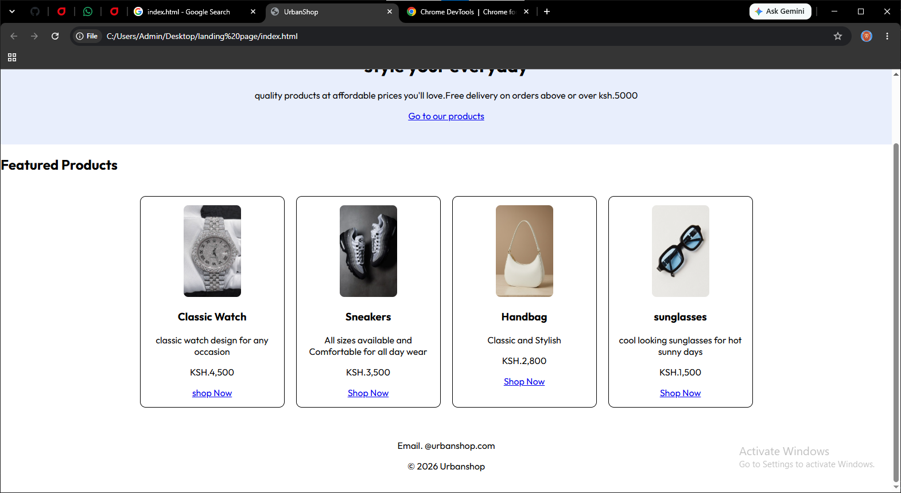
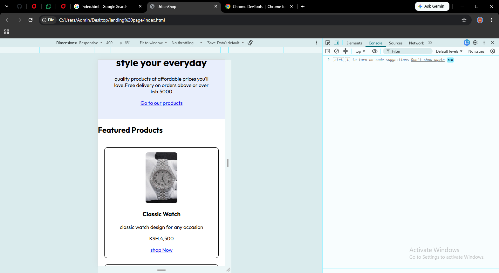

# UrbanShop Landing Page

This is a simple landing page for an online store called UrbanShop. I built it with HTML and CSS as part of my web development course.

## What's on the page

- A header with the logo and menu links
- A welcome section with a button that jumps to the products
- Four product cards: a watch, sneakers, a handbag and sunglasses
- A footer with contact details

## Why I designed it this way

- **Flexbox and Grid:** Flexbox aligns the header and menu, while CSS Grid arranges the product cards and adapts them to different screen sizes.
- **Colors:** I used a black header, a soft blue-gray welcome section and a light background so the products stand out.
- **Font:** I picked Outfit from Google Fonts because it looks clean and modern.
- **Product cards:** Every card has the same layout, so the page looks tidy.
- **Mobile friendly:** On phones, the menu stacks up and the cards sit in one column so everything is easy to read.

## Screenshots

## Files

- `index.html`: the page content
- `style.css`: the styling
- `desktop.png` and `mobile.jpg`: desktop and mobile previews
- `watch.jpg`, `shoes.jpg`, `handbag.jpg` and `sunglasses.jpg`: product photos

[def]: desktop.png